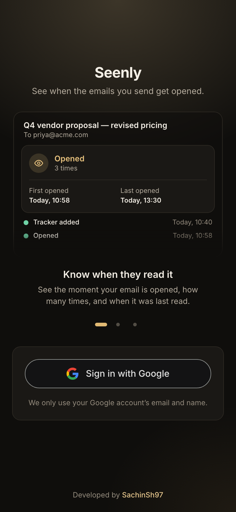
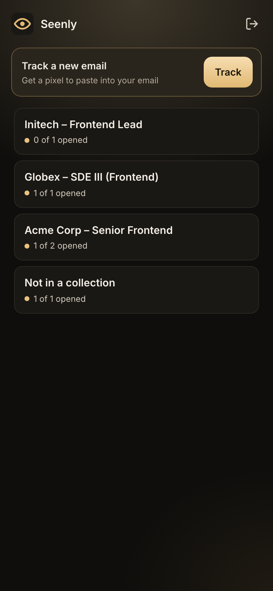
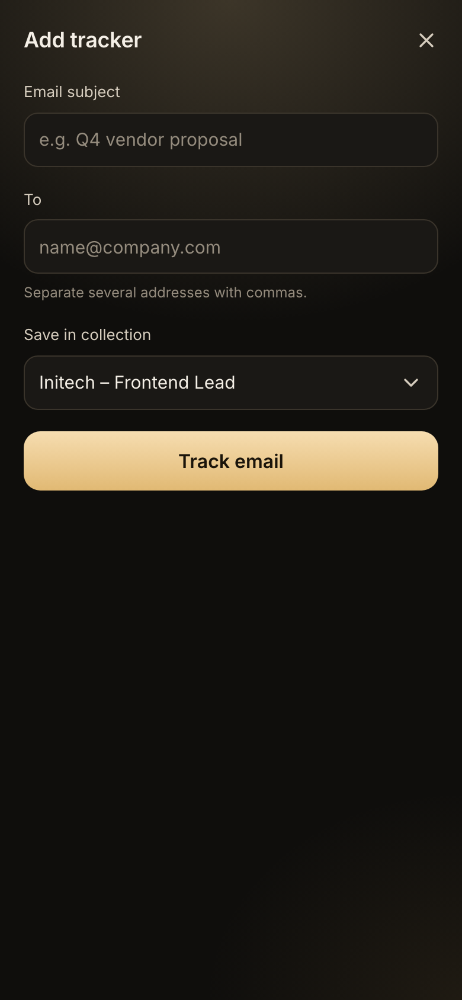
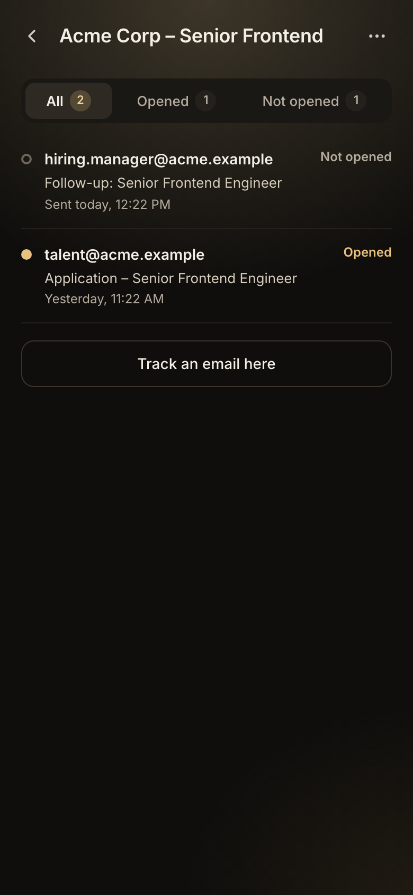
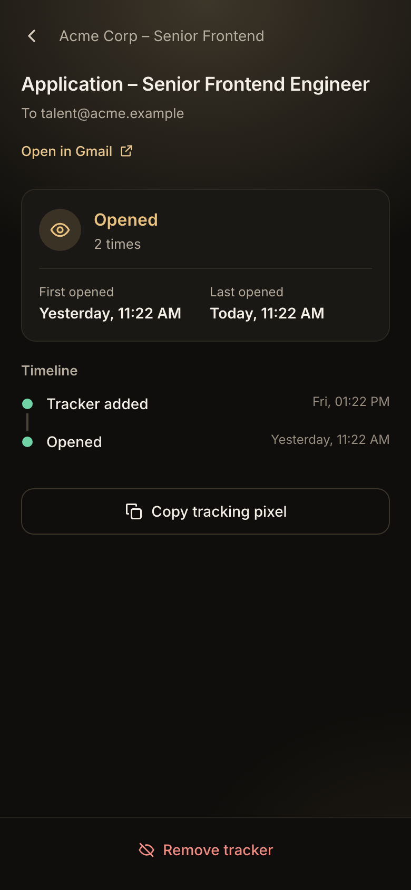
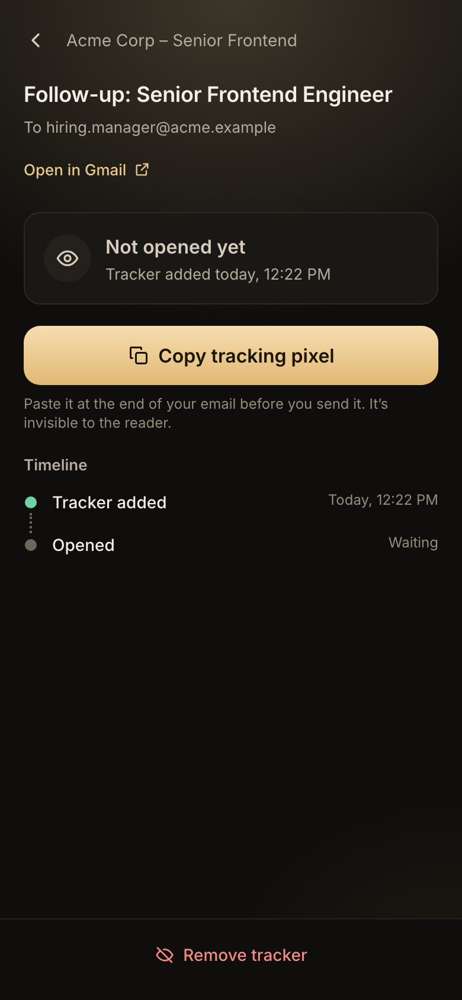

# Mail Tracker

See when the emails you send get opened. No browser extension needed.

Create a tracker, paste its invisible pixel into your Gmail message, send it, and Mail Tracker tells
you when the recipient opens it.

<table>
  <tr>
    <td align="center"><br><sub>Sign in with Google</sub></td>
    <td align="center"><br><sub>Collections at a glance</sub></td>
    <td align="center"><br><sub>Add a tracker</sub></td>
  </tr>
  <tr>
    <td align="center"><br><sub>Emails in a collection</sub></td>
    <td align="center"><br><sub>Opened: when and how often</sub></td>
    <td align="center"><br><sub>Not opened yet: copy the pixel</sub></td>
  </tr>
</table>

## How it works

```
1. In Mail Tracker            2. In Gmail                      3. Recipient opens the email
   "Track email"                 paste the pixel, send            their mail app loads the pixel
        │                                                                   │
        ▼                                                                   ▼
   ┌─────────┐   creates a tracker   ┌─────────┐   GET /t/<id>/pixel.gif   ┌─────────┐
   │ client  │ ────────────────────► │ service │ ◄──────────────────────── │  Gmail  │
   │ (React) │ ◄──── "Opened" ────── │ (API)   │                           │  proxy  │
   └─────────┘                       └────┬────┘                           └─────────┘
                                          │
                                     ┌────▼────┐
                                     │  Neon   │  users, collections, trackers, hits
                                     │Postgres │
                                     └─────────┘
```

Every tracker has its own invisible 1×1 image, the **pixel**. When the email is shown, the mail app downloads
the pixel from the service. The first real download marks the email as **opened**. Every download is logged,
including the ones that are ignored.

## What's built (v1)

| Area                  | What you get                                                                                                                                   |
| --------------------- | ---------------------------------------------------------------------------------------------------------------------------------------------- |
| **Sign in**           | One click with Google. No passwords, no sign-up form. You stay signed in for 30 days.                                                          |
| **Trackers**          | One per email, with subject and recipients. **Copy tracking pixel** puts the image itself on your clipboard, so pasting into Gmail just works. |
| **Collections**       | Optional groups, e.g. one per company, showing "x of y opened". Trackers can also stand alone.                                                 |
| **Open detection**    | An email is marked opened **once**. Repeat opens are counted, with first and last opened times and a timeline.                                 |
| **Fewer false opens** | Ignores security scanners and bots, your own IP address, and loads in the first 60 seconds (e.g. your own draft).                              |
| **Privacy**           | Every user only sees their own data. Sign-in uses only your Google email and name.                                                             |
| **Quality**           | 60 automated API tests run against a real Postgres. Strict TypeScript, and a consistent error format.                                          |

## Tech stack

| Part         | Stack                                                              |
| ------------ | ------------------------------------------------------------------ |
| **client/**  | React 19, TypeScript, Vite, Tailwind CSS, React Router             |
| **service/** | Node.js 20, TypeScript, Express 5, Prisma 7, Zod, jose (JWT), pino |
| **Database** | PostgreSQL on [Neon](https://neon.tech) (free tier)                |
| **Tests**    | Vitest, Supertest, embedded Postgres (no Docker needed)            |

```
mail-tracker/
├─ client/     web app            → details in client/README.md (screenshots in client/designs/)
└─ service/    REST API + pixel   → details in service/README.md (endpoints, rules, scripts)
```

## Setup

You need **Node.js 20.19+**, **pnpm** (for the client), and free accounts on **Neon** and **Google Cloud**.
No credit card is required.

### 1. Create the database (Neon)

1. Sign up at [neon.tech](https://neon.tech) and create a project. Pick the region closest to you.
2. Click **Connect**, turn **Connection pooling off**, and copy the connection string.

### 2. Set up "Sign in with Google" (Google Cloud)

1. At [console.cloud.google.com](https://console.cloud.google.com), create a project.
2. Open **Google Auth Platform** → **Get started**. Enter the app name and your email, and choose audience **External**.
3. Go to **Audience** → **Test users** and add your Gmail address.
4. Go to **Clients** → **Create client** → **Web application**, and enter:
   - Authorized JavaScript origins: `http://localhost:5173`
   - Authorized redirect URIs: `http://localhost:5173/auth/callback`
5. Copy the **Client ID**. It isn't secret.

### 3. Start the service

```bash
cd service
cp .env.example .env
```

Fill in `service/.env`:

| Variable           | Value                                                                                |
| ------------------ | ------------------------------------------------------------------------------------ |
| `DATABASE_URL`     | the Neon connection string                                                           |
| `GOOGLE_CLIENT_ID` | the Client ID from step 2                                                            |
| `SESSION_SECRET`   | output of `node -e "console.log(require('crypto').randomBytes(32).toString('hex'))"` |
| `PUBLIC_BASE_URL`  | `http://localhost:4000` locally (see the note below)                                 |

```bash
npm install
npm run db:deploy    # creates the tables
npm run dev          # http://localhost:4000, check http://localhost:4000/health
```

### 4. Start the web app

```bash
cd client
cp .env.example .env    # set VITE_GOOGLE_CLIENT_ID to the same Client ID
pnpm install
pnpm dev                # http://localhost:5173
```

### 5. Track a real email

> **Important:** a pixel pointing at `localhost` only works on your own computer. Gmail loads images through
> Google's servers, which can't reach your laptop. To track real emails, deploy it: see [DEPLOY.md](DEPLOY.md).

1. Click **Track**, then enter the subject and recipient.
2. Click **Copy tracking pixel**, paste it at the end of your Gmail message, and send.
3. Wait at least a minute, then open the email from the recipient's side. It shows as **Opened**.

Run the tests with `cd service && npm test`.

## Good to know

- **One tracker per recipient.** If one email goes to several people, they all load the same pixel, so you only
  learn that _someone_ opened it.
- **Gmail** loads images through its own proxy. Opens are detected, but the reader's location and device aren't.
- **Apple Mail** may pre-load images, which can show an email as opened before anyone reads it.
- **Outlook** often blocks images until the reader allows them, so some opens are never reported.

## Next phase

| #   | Step                                                                               | Why                                                                                                            |
| --- | ---------------------------------------------------------------------------------- | -------------------------------------------------------------------------------------------------------------- |
| 1   | **Deploy** to Render with [`render.yaml`](render.yaml): see [DEPLOY.md](DEPLOY.md) | Gives the pixel a public address, so real opens can be tracked                                                 |
| 2   | **Test with real inboxes**: Gmail, Outlook, Apple Mail; check spam placement       | Confirms which mail apps report opens, and that emails still reach the inbox                                   |
| 3   | **"Mark as sent"**                                                                 | Starts counting opens only after you've sent the email, so viewing your own draft or Sent folder isn't counted |
| 4   | **Per-recipient tracking helper**                                                  | Creates one tracker per recipient in a single step, so you know exactly who opened                             |
| 5   | **Own domain**                                                                     | A custom domain for the pixel, which looks more trustworthy and helps delivery                                 |

---

<p align="center">Developed by <a href="https://github.com/SachinSh97">SachinSh97</a></p>
